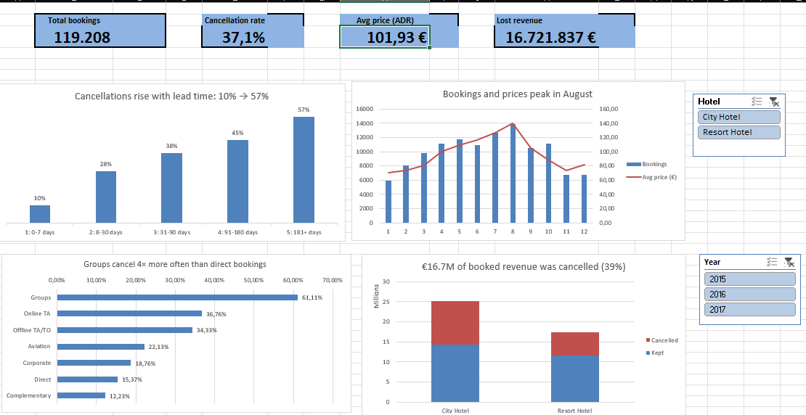
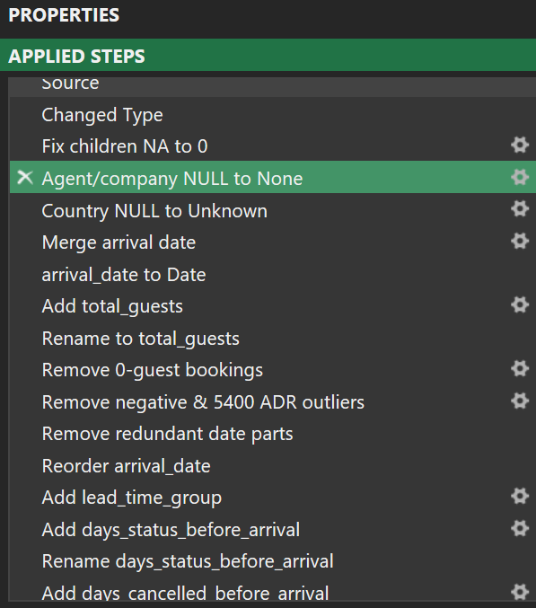
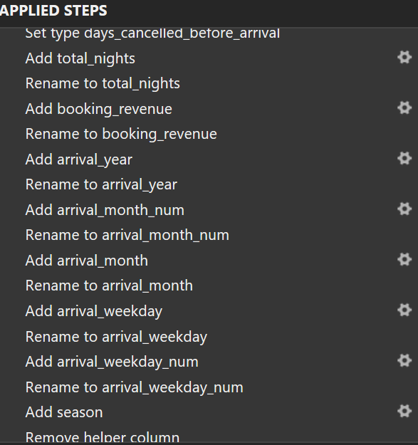
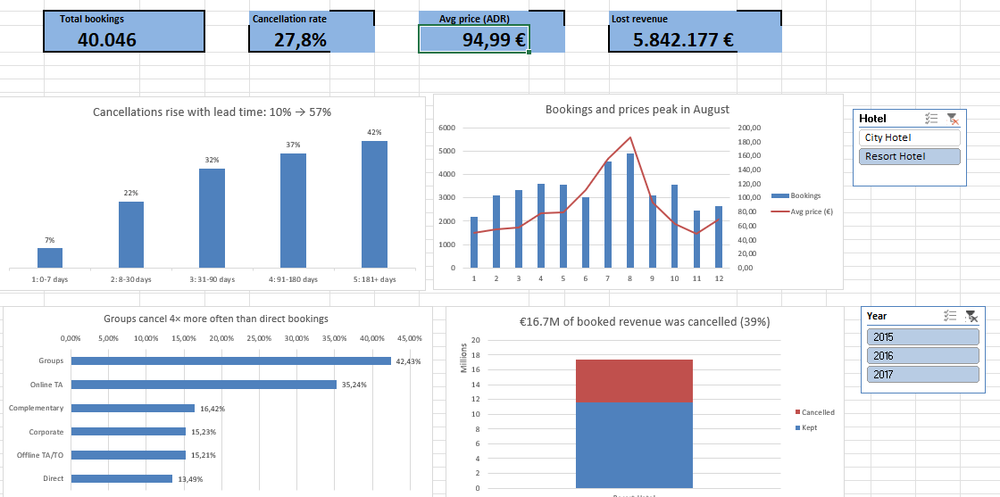

# Hotel Booking Performance & Cancellation Analysis (Excel)

An end-to-end Excel project: raw data cleaned in **Power Query**, analysed with **PivotTables**, and presented in an **interactive dashboard** with slicers and KPI cards.

**Main finding:** 37% of all bookings were cancelled, which cost the two hotels **€16.7M in booked revenue** over two years. Cancellations are driven mainly by **long lead times** and **group / tour-operator bookings**, and are concentrated at the **City Hotel**.

---

## Why this project

Hotels lose profit when decisions are based on habit instead of data. After 16 years working in hospitality, I wanted to answer a question I saw every day from the inside: **where do cancellations come from, and what can management do about them?**

## Business questions

| # | Question |
|---|---|
| Q1 | What is the overall cancellation rate, and how does it differ between City Hotel and Resort Hotel? |
| Q2 | Which months bring the most bookings and the highest average daily rate (ADR)? |
| Q3 | Which market segments cancel most? |
| Q4 | Does lead time (days between booking and arrival) predict cancellation? |
| Q5 | How much revenue was lost to cancellations? |
| Q6 | Which deposit type is most reliable? |

## Data

- **Source:** Antonio, Almeida & Nunes (2019), *Hotel booking demand datasets*, Data in Brief 22, 41–49 ([doi:10.1016/j.dib.2018.11.126](https://doi.org/10.1016/j.dib.2018.11.126)), via [TidyTuesday](https://github.com/rfordatascience/tidytuesday/tree/master/data/2020/2020-02-11)
- **Scope:** two hotels in Portugal (a City Hotel and a Resort Hotel), arrivals July 2015 – August 2017
- **Size:** 119,390 bookings, 32 columns (raw) → 119,208 bookings, 40 columns (clean)
- ADR (average daily rate) is in EUR

## Tools

Microsoft Excel: **Power Query** (cleaning and calculated columns), **PivotTables**, **PivotCharts**, **slicers**, **GETPIVOTDATA** (KPI cards)

## Process

### 1. Cleaning (Power Query)

Every step is recorded in Power Query, so the whole process can be repeated with one click on **Refresh**. The full log is in the `Cleaning_Log` sheet.

| Step | Action | Rows affected |
|---|---|---|
| 1 | Replaced "NA" errors in `children` with 0 | 4 |
| 2 | Replaced text "NULL" in `agent` / `company` with "None" (means no agent / company, not missing data) | 16,340 / 112,593 |
| 3 | Replaced "NULL" in `country` with "Unknown" | 488 |
| 4 | Merged year, month and day into one real `arrival_date` (English UK locale) | all rows |
| 5 | Removed bookings with 0 guests (impossible) | 180 removed |
| 6 | Kept ADR between 0 and 1,000 (removed one negative value and one outlier of 5,400) | 2 removed |
| 7 | **Investigated duplicates and kept them** (see below) | 31,980 kept |
| 8 | Removed redundant date columns | 4 columns |
| 9–10 | Added calculated columns (see below) | 10 columns |

**The duplicate decision:** the data has no booking ID, so 27% of rows looked like duplicates. Before deleting, I investigated: they are mostly **group and tour-operator block bookings** (42% Groups, 36% Non Refund, 58% cancelled vs 37% overall). Removing them would have hidden the main cancellation driver, so they were kept.

 

### 2. Calculated columns

`total_nights`, `booking_revenue` (ADR × nights), `arrival_year`, `arrival_month_num`, `arrival_month`, `arrival_weekday`, `arrival_weekday_num`, `season`, `lead_time_group` (5 groups), `days_cancelled_before_arrival`

### 3. Analysis and dashboard

One PivotTable per business question (sheets `Q1` to `Q6`), four PivotCharts on the `Dashboard` sheet, two slicers (Hotel, Year) connected to every PivotTable, and four KPI cards linked with GETPIVOTDATA, so **the whole dashboard updates when a slicer is clicked**.

## Key findings

| Q | Answer |
|---|---|
| Q1 | **37.1%** of bookings were cancelled: City Hotel **41.8%**, Resort Hotel **27.8%** |
| Q2 | **August** is the peak: 13,861 bookings, ADR €140, about 2× January (5,921 bookings, ADR €70) |
| Q3 | **Groups cancel 61%** of the time, four times more often than direct bookings (15%) |
| Q4 | The cancellation rate rises with lead time, from **9.6%** (0–7 days) to **57%** (181+ days) |
| Q5 | **€16.7M** of €42.7M booked revenue was cancelled (39%); City Hotel accounts for €10.9M |
| Q6 | Non-refundable bookings show **99.4%** cancellations, most likely group / tour-operator block releases (to be verified with the hotel) |

## Recommendations

1. **Long-lead bookings:** introduce a partial non-refundable deposit (e.g. 20–30%) for bookings made more than 90 days before arrival.
2. **Group contracts:** require a binding release date (e.g. 30 days before arrival). Unconfirmed rooms go back to sale, and later cancellations are charged.
3. **Focus on City Hotel:** review group and tour-operator contracts there first, and track the cancellation rate per agency.
4. **Seasonal pricing:** discounts and packages in the low months (November–February), higher prices and stricter cancellation terms in July–August, especially at the Resort.

Full reasoning for each recommendation is in the `Insights` sheet.

## Limitations

- Hotel names are anonymised and the data ends in 2017, so the findings show patterns, not current figures.
- There is no booking ID, so true duplicates cannot be separated from identical group bookings.
- The 99% cancellation rate for non-refundable bookings should be confirmed with the hotel's revenue manager before acting on it.
- Chart titles describe the full dataset; slicers update the charts and KPI cards.

## Files

| File | Content |
|---|---|
| `Hotel_Bookings_Dashboard.xlsb` | The full workbook: raw data, Power Query, clean data, PivotTables, dashboard, cleaning log, insights |
| `images/` | Dashboard and Power Query screenshots |

**How to use:** open the file in Excel, go to the `Dashboard` sheet and click the Hotel or Year slicer.

## About me

Matthew Okeke, career changer from 16 years in hospitality into data analytics.
[LinkedIn](https://www.linkedin.com/in/matthewokeke/) · More projects: [Stuttgart Population Dashboard (Power BI)](https://github.com/softwarehype/stuttgart-population-dashboard) · [BW EV Charging (SQL)](https://github.com/softwarehype/bw-ev-charging-sql)
